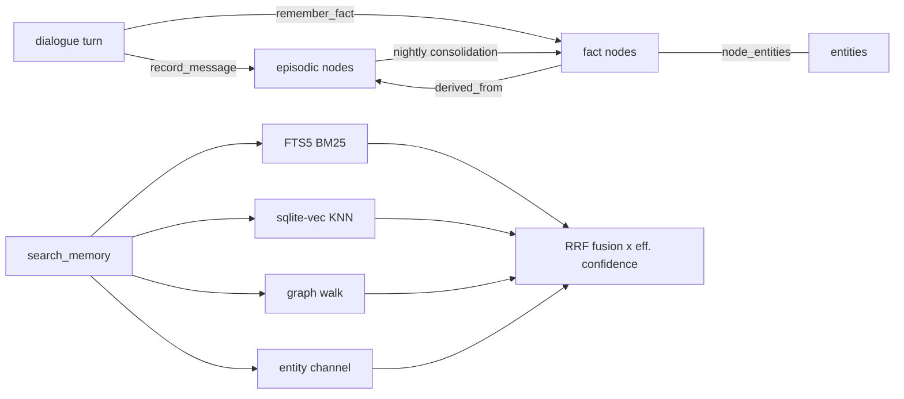

# memory-mcp

[](https://github.com/evrelse12/memory-mcp-server/actions/workflows/ci.yml)
[](LICENSE)
[](pyproject.toml)

Long-term memory for local LLMs: a SQLite-backed knowledge graph of episodes,
facts and entities, with hybrid search, Ebbinghaus-style forgetting and
MCP tools. Runs as a single stdio process spawned by `llama-server` (or any MCP
client). Fully offline: local chat model + local embeddings, no cloud, no Docker.

## Why this one

| | infra | forgetting | provenance | offline |
|---|---|---|---|---|
| official KG memory server | JSON file | – | – | yes |
| mem0 / OpenMemory | hosted | – | partial | no |
| Zep / Graphiti | Neo4j / cloud | partial | yes | partial |
| mcp-memory-service | sqlite-vec + extras | – | partial | yes |
| **memory-mcp** | **one SQLite file** | **Ebbinghaus + reinforcement** | **explain_fact** | **yes** |

## Principles

Memory is a **directed, typed graph** in SQLite, built by four mechanisms:

1. **Hot path** — every dialogue turn is recorded as an immutable episode.
2. **Online fact extraction** — durable facts stored immediately, vector-deduped.
3. **Nightly consolidation** — a background agent re-reads finished sessions.
4. **Decay & maintenance** — unused facts fade; a nightly job keeps the DB healthy.



### Nodes

| Type | Purpose | Decay |
|------|---------|-------|
| `episodic` | Immutable dialogue turns | No |
| `semantic` | Facts about the world | Yes |
| `procedural` | Skills and habits | Yes |
| `opinion` | Subjective preferences | Yes |

Each node carries `content`, `confidence`, `decay_rate`, `last_accessed`,
`needs_embedding`, `valid_until` (soft-delete), `session_id`, `event_time`, `metadata`.

### Edges

| Type | Direction | Meaning |
|------|-----------|---------|
| `derived_from` | fact → episode | provenance |
| `entity` | node → entity (via `node_entities`) | mentions |
| `supersedes` | new fact → old fact | correction chain |
| `temporal`, `causal` | reserved | schema supports, nothing writes them |

### Entities

`canonical_name`, `aliases` (JSON, never overwritten), LLM `summary`,
`mention_count`. New names are disambiguated **by embedding** against
`vec_entities` (threshold `entity_match_threshold`), so "Гугл" lands on
"Google" instead of creating a duplicate. Matching uses one combined
word-boundary regex (longest-first), rebuilt lazily.

## Forgetting: the Ebbinghaus formula

```
eff = confidence * exp(-decay_rate * idle_days ** decay_exponent)
```

`idle_days` is measured from **`last_accessed`** (fallback `created_at`):
looking a fact up resets the curve. Nightly `DecayService`:
`expire_weak` (eff < `decay_threshold`) then `purge_expired`
(soft-deleted older than `soft_delete_retention_days`).
Pinned facts (`confirm_fact`) have `decay_rate=0`, `confidence=1`.

## Building the graph

### Online path

`record_message` writes the exact user text as an episode (per-session lock,
entity links, background embedding). Sessions: the host may pass an explicit
`session_id`; otherwise the server auto-manages one and **rotates it after
`session_timeout_minutes` of idle**, so a finished conversation becomes
consolidatable without waiting for 03:00 or a restart.

`remember_fact` embeds once, then vector-dedupes:
`sim ≥ dedup_similarity_threshold` → `duplicate` (reinforced, optionally pinned);
`sim ≥ conflict_band_min` → `similar` (use `correct_fact` or `force=true`);
else insert. Facts stored while the embedder was down are merged later by the
nightly **retro-dedup sweep** (provenance is preserved).

### Nightly consolidation

Sessions whose latest episode is older than the timeout AND newer than
`consolidated_at` are chunked and sent to the LLM for fact extraction with
per-fact sources and entities. Only **user** episodes are extracted by default
(`consolidate_assistant=false`); assistant text stays in the timeline but never
becomes a fact. In the conflict band the LLM arbitrates `same | contradicts |
different`; a contradiction supersedes the old fact **preserving its type**.
Failures leave `consolidated_at` untouched → retry next run.

## Searching the graph

`search_memory` runs FTS5, vec and entity channels **in parallel**
(`asyncio.gather`), then a one-hop graph walk from the top vec/FTS seeds, and
fuses with RRF: `score = Σ weight_c / (rrf_k + rank_c + 1)`, multiplied by
effective confidence. KNN overfetches (`knn_k * vec_overfetch`) because the
type filter runs after KNN and episodes share the vector table. FTS handles
Russian via stop-words + crude prefix stemming; English via porter. Top-3 hits
are reinforced in the background (never blocks the read).

## Resources

Read-only context endpoints. Hosts decide whether to inject them — MCP resources
are application-driven, so they are a convenience, **not a guarantee**.
`get_turn_context` plus the reference system prompt remain the reliable path.

| URI | Content | priority |
|---|---|---|
| `memory://user/profile` | pinned semantic facts | 1.0 |
| `memory://user/constraints` | hard rules (`constraint=true`) | 1.0 |
| `memory://user/preferences` | pinned opinions | 0.8 |
| `memory://session/{session_id}/summary` | extractive session digest | 0.6 |
| `memory://entities/{entity_id}` | entity profile + linked facts | 0.5 |
| `memory://episodes/recent` | last dialogue episodes | 0.3 |

All are `text/markdown`, audience `assistant`. Digests are extractive (no LLM call).

## Tools

| Tool | Purpose |
|------|---------|
| `record_message` | Write the user's exact text as an episode. First call every turn. Optional `session_id`. |
| `search_memory` | Hybrid search over facts (and optionally episodes). |
| `remember_fact` | Store a durable fact; may return `duplicate`/`similar`. |
| `correct_fact` | Replace an outdated fact (preserves type via `supersedes`). |
| `confirm_fact` | Pin permanently. |
| `forget_fact` | Soft- or hard-delete. |
| `get_entity_info` | Entity profile: summary, aliases, linked facts. |
| `get_timeline` | Last N episodes chronologically. |
| `memory_stats` | Graph metrics, `pending_embeddings`, live `vec_available`. |
| `explain_fact` | Provenance: sources, supersedes chain, entities. |
| `weak_facts` | Facts below effective confidence 0.3. |

## Maintenance

One `AsyncIOScheduler`: nightly cron (`consolidation_cron_hour:minute`),
a periodic **consolidation tick** (every `session_timeout_minutes`), and a
catch-up on start when `last_maintenance_ts` > 20 h. Steps, in order:
**consolidate → dedup → decay → enrich → housekeep**
(backfill embeddings, FTS optimize, WAL checkpoint, PRAGMA optimize).
A global lock prevents overlap.

## Install

```bash
python3 -m venv venv && source venv/bin/activate
pip install -e ".[dev]"
cp .env.example .env   # adjust URLs and models
```

## Run (stdio)

`~/.config/llama-server/mcp_config.json`:

```json
"memory": {
  "command": "<project>/venv/bin/python3",
  "args": ["<project>/main.py"],
  "env": { "FASTMCP_CHECK_FOR_UPDATES": "off" }
}
```

Or, inside the venv: `memory-mcp`. No systemd unit, crontab or HTTP daemon needed.

### Troubleshooting: client reports 0 tools

The MCP client usually hides the child's stderr. Run the server the same way the
client does and read the real error:

```bash
./venv/bin/python main.py < /dev/null
```

Common causes: a bad env var in the client's MCP config (FastMCP 4.x wants
`FASTMCP_CHECK_FOR_UPDATES=off`, not `false`), or the startup fail-fast on
`embedding_model`/`embedding_dim` mismatch — env from the client config
overrides `.env`.

## Run (HTTP, multi-client)

Opt-in shared server for several clients. Set `MEMORY_TRANSPORT=http` (+
`MEMORY_HTTP_HOST/PORT/PATH/TOKEN`) and run `memory-mcp`; endpoint
`http://127.0.0.1:8090/mcp`, bearer-token auth. See [docs/HTTP.md](docs/HTTP.md)
for security, client config, systemd and the multi-client/llama-server notes.

## Configuration

All vars use the `MEMORY_` prefix (see `.env.example`). Defaults:

| Env | Default | Meaning |
|---|---|---|
| `DATA_DIR` | `~/memory` | data root |
| `DB_PATH` / `LOG_PATH` | derived | override locations |
| `LLM_API_URL` / `LLM_MODEL` | `127.0.0.1:9931` / gemma | consolidation LLM |
| `LLM_TIMEOUT` / `LLM_MAX_TOKENS` | 60 / 2048 | |
| `EMBEDDING_API_URL` / `EMBEDDING_MODEL` | `127.0.0.1:8081` / nomic-v2-moe | |
| `EMBEDDING_DIM` | 256 | Matryoshka truncation |
| `EMBEDDING_TIMEOUT` / `EMBEDDING_CONNECT_TIMEOUT` | 10 / 3 | |
| `EMBEDDING_QUERY_PREFIX` / `EMBEDDING_DOCUMENT_PREFIX` | `search_query: ` / `search_document: ` | |
| `EMBEDDING_TRUNCATE_MATRYOSHKA` | true | |
| `SESSION_TIMEOUT_MINUTES` | 30 | idle → session rotation / consolidation |
| `CONSOLIDATION_CRON_HOUR` / `..._MINUTE` | 3 / 0 | nightly time |
| `CONSOLIDATION_CHUNK_CHARS` | 6000 | |
| `MAX_FACTS_PER_LLM_CALL` | 12 | |
| `CONSOLIDATE_ASSISTANT` | false | extract facts from assistant text |
| `CONFLICT_BAND_MIN` | 0.80 | LLM arbitration lower bound |
| `DEDUP_SIMILARITY_THRESHOLD` | 0.92 | duplicate upper bound |
| `DEDUP_KNN_K` | 512 | dedup overfetch |
| `VEC_OVERFETCH` | 8 | search KNN multiplier |
| `DEDUP_SWEEP_LIMIT` | 200 | nightly retro-dedup, 0 = off |
| `ENTITY_MATCH_THRESHOLD` / `ENTITY_KNN_K` | 0.90 / 5 | entity disambiguation |
| `DEFAULT_DECAY_RATE` / `DECAY_THRESHOLD` / `DECAY_EXPONENT` | 0.1 / 0.05 / 0.8 | |
| `EPISODE_RETENTION_DAYS` | 0 | 0 = keep forever |
| `SOFT_DELETE_RETENTION_DAYS` | 30 | audit grace period |
| `MAX_EPISODE_CHARS` | 4000 | |
| `RRF_K` / `KNN_K` | 60 / 20 | |
| `RRF_WEIGHT_FTS` / `..._VEC` / `..._GRAPH` | 1.0 | entity weight fixed 0.8 |
| `MAX_SEARCH_LIMIT` | 50 | |
| `LOG_LEVEL` | INFO | |
| `LOG_TO_FILE` | false | opt-in rotating file log (5 MB × 3) |
| `TRANSPORT` | (stdio) || 
| `HTTP_HOST` | (127.0.0.1) ||
| `HTTP_PORT` | (8090) ||
| `HTTP_PATH` | (/mcp) ||
| 'HTTP_TOKEN` | (—) ||

## Tests

```bash
pytest -q
```

## Schema invariants

- `nodes.rid` is the explicit autoincrement PK; FTS5 rowid joins against it, stable across VACUUM.
- FTS triggers fire only on actual `content` changes.
- `vec_nodes` / `vec_entities` dimension comes from settings; startup verifies `meta.embedding_dim`/`embedding_model` and fails fast on mismatch.
- Unique `(source_id, target_id, relation_type)` edge index makes `ON CONFLICT DO NOTHING` dedupe.
- `node_entities(entity_id)` is indexed.

## Limitations

- Online ingestion relies on the model calling `record_message` every turn; small models sometimes skip it. Deterministic ingestion needs a proxy/pipe in front of the client.
- Secrets are not filtered yet; scrub the DB before sharing.
- Single-user, single-process by design.

## License

MIT — see [LICENSE](LICENSE).
