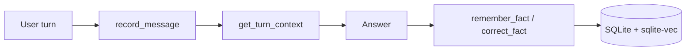
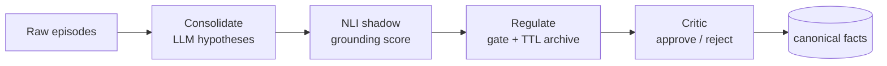

<div align="center">

# 🧠 memory-mcp-server

**Persistent, verified long-term memory for local LLMs — in a single SQLite file.**

Fully offline · No cloud · No external vector DB · No telemetry

[](https://github.com/evrelse12/memory-mcp-server/actions/workflows/ci.yml)
[](LICENSE)
[](https://www.python.org)
[](https://github.com/astral-sh/ruff)
[](https://modelcontextprotocol.io)
[](docs/CONTRIBUTING.md)

[Quick start](#-quick-start) ·
[How it works](#-how-it-works) ·
[Benchmarks](#-benchmarks) ·
[Comparison](#-comparison) ·
[Docs](#-documentation) ·
[ Roadmap](#-roadmap)

</div>

---

## Why this exists

Local LLMs forget everything between sessions. Bolting on a vector database gives
you *search*, not *memory*: no forgetting, no provenance, no guard against
confident-but-wrong inferences.

**memory-mcp-server** is a memory layer that behaves like memory: it consolidates
experience, forgets what stops mattering, traces every fact to its source, and
quarantines unverified LLM inferences until an adversarial critic proves them
against the original dialogue. All of it in one portable `.db` file, on your machine.

## ✨ Highlights

- 🗃 **Single-file storage** — SQLite (WAL) + `sqlite-vec`. Nothing else to deploy.
- 🔍 **Hybrid retrieval** — FTS5 (RU/EN) + dense KNN + RRF + graph & entity channels.
- 📉 **Forgetting as a feature** — Ebbinghaus decay, reinforcement on use, nightly purge.
- 🛡 **Verified memory** — Consolidation → Reflection: NLI gate + adversarial LLM critic;
  hypotheses never reach answers until proven.
- 🧾 **Provenance** — `derived_from` source episodes and `supersedes` correction chains;
  `explain_fact` shows the full trail.
- 📌 **Directives & conflicts** — hard constraints always in context; contradictions
  trigger a user question, never a silent overwrite.
- 🔌 **Two transports** — stdio for desktop hosts, HTTP + bearer for multi-client.
- 🏠 **Local-first** — FastMCP telemetry & update checks disabled by default.

## 🚀 Quick start

```bash
git clone https://github.com/evrelse12/memory-mcp-server.git
cd memory-mcp-server
python3 -m venv venv && ./venv/bin/pip install -e .
```

Point it at an embedding server and a chat server (llama.cpp `llama-server` works):

```bash
# embeddings (CPU is fine)
llama-server -m nomic-embed-text-v2-moe-q8_0.gguf --embedding --pooling mean --port 8081
# chat
llama-server -m <chat-model>.gguf -a <alias> --jinja --port 9931
```

Run as an MCP server (stdio) or wire it into your host:

```json
{ "mcpServers": { "memory": {
  "command": "/path/to/venv/bin/python3",
  "args": ["/path/to/main.py"],
  "env": {
    "MEMORY_DATA_DIR": "/path/to/project",
    "MEMORY_LLM_API_URL": "http://localhost:9931",
    "MEMORY_EMBEDDING_API_URL": "http://localhost:8081",
    "FASTMCP_CHECK_FOR_UPDATES": "off",
    "FASTMCP_TELEMETRY_MODE": "off"
  }
}}}
```

Full installation, systemd units and HTTP mode: **[docs/INSTALL.md](docs/INSTALL.md)**,
**[docs/HTTP.md](docs/HTTP.md)**.

## 🧠 How it works

**Per turn** — record, recall, answer, store:



**Nightly** — Consolidation → Reflection:



A fact stated by the user is canonical immediately. A fact *inferred* by the LLM is a
hypothesis: hidden from answers, screened by a multilingual NLI model against its
source episodes, then judged by a critic that must cite evidence. Details:
**[docs/CONSOLIDATION_REFLECTION.md](docs/CONSOLIDATION_REFLECTION.md)**.

## 📊 Benchmarks

Evaluated on **LongMemEval_S** (20-item stratified sample) with a local judge:

| Metric | Result |
|---|---|
| CI test-suite | **66 passed** (Ubuntu + Windows) |
| Retrieval recall@8 (session-level) | **1.00** |
| **Memory** answer accuracy | **0.53** |
| **No-memory** control accuracy | **0.20** |

Same 20 LongMemEval_S questions, same local judge: memory more than doubles the
no-memory control, and retrieval finds the evidence session in every sampled
question. An embedding A/B (nomic vs bge-m3) was run but is **inconclusive** at this
sample size — nomic remains the default. Full tables, per-kind breakdown and caveats:
**[docs/BENCHMARKS.md](docs/BENCHMARKS.md)**.

## 🆚 Comparison

| | memory-mcp | mem0 | Zep | Letta (MemGPT) | plain RAG |
|---|:---:|:---:|:---:|:---:|:---:|
| One portable file | ✅ | ❌ | ❌ | ❌ | ❌ |
| Fully offline | ✅ | optional | ❌ | optional | depends |
| Forgetting / decay | ✅ | partial | temporal | agent | ❌ |
| Hypothesis verification | ✅ | ❌ | ❌ | ❌ | ❌ |
| Provenance chain | ✅ | partial | ✅ | partial | ❌ |
| Hard directives | ✅ | ❌ | ❌ | ❌ | ❌ |

## ⚙️ Configuration

Everything is env-driven (`MEMORY_*`), with sane defaults:

```bash
MEMORY_DATA_DIR=/path/to/project
MEMORY_LLM_API_URL=http://localhost:9931
MEMORY_EMBEDDING_API_URL=http://localhost:8081
MEMORY_TRANSPORT=stdio          # or http (+ MEMORY_HTTP_TOKEN)
```

Full reference, reflection thresholds and FastMCP runtime flags:
**[docs/CONFIGURATION.md](docs/CONFIGURATION.md)**.

## 📚 Documentation

| | |
|---|---|
| 📦 [Installation](docs/INSTALL.md) | servers, systemd, host wiring |
| ⚙️ [Configuration](docs/CONFIGURATION.md) | every env var, fail-fast rules |
| 🏗 [Architecture](docs/ARCHITECTURE.md) | storage, schema v4, hybrid search |
| 🛡 [Consolidation & Reflection](docs/CONSOLIDATION_REFLECTION.md) | the verification pipeline |
| 🔌 [HTTP transport](docs/HTTP.md) | bearer auth, multi-client |
| 📝 [System prompt](docs/SYSTEM_PROMPT.md) | reference per-turn protocol |
| 📊 [Benchmarks](docs/BENCHMARKS.md) | protocol, results, embedding A/B |
| 🧯 [Troubleshooting](docs/TROUBLESHOOTING.md) | "0 tools", empty content, macOS |

## 🗺 Roadmap

- [x] Hybrid retrieval + Ebbinghaus forgetting
- [x] Directives, conflicts, provenance
- [x] HTTP transport + bearer auth
- [x] Consolidation → Reflection (NLI gate + adversarial critic)
- [x] Benchmark harness (LongMemEval / LoCoMo)
- [ ] Finalize v0.8.0 benchmark tables & release
- [ ] Measured embedding A/B (nomic vs bge-m3)
- [ ] Optional small ONNX judge / agentic critic

## 🤝 Contributing

Issues and PRs welcome. Run `./venv/bin/pytest -q` and `./venv/bin/ruff check .`
before submitting. See [docs/CONTRIBUTING.md](docs/CONTRIBUTING.md).

## 📄 License

MIT © [evrelse12](https://github.com/evrelse12)

<div align="center">
<sub>Built for local-first, privacy-respecting AI. One file, real memory.</sub>
</div>
