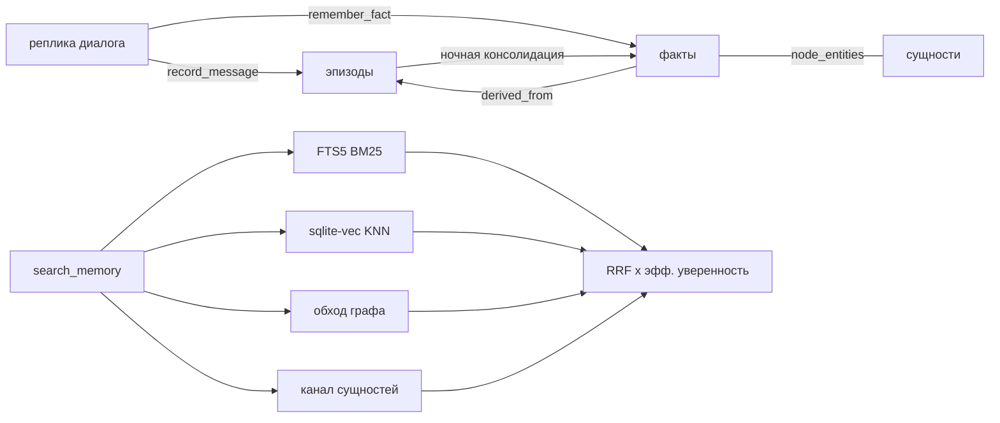

# memory-mcp

[](https://github.com/evrelse12/memory-mcp-server/actions/workflows/ci.yml)
[](LICENSE)
[](pyproject.toml)

Долговременная память для локальных LLM: граф знаний на SQLite из эпизодов,
фактов и сущностей, гибридный поиск, забывание по Эббингаузу и MCP-инструменты.
Один stdio-процесс, запускаемый `llama-server` (или любым MCP-клиентом).
Полностью офлайн: локальная чат-модель + локальные эмбеддинги, без облака и Docker.

## Почему этот

| | инфраструктура | забывание | провенанс | офлайн |
|---|---|---|---|---|
| официальный KG memory | JSON-файл | – | – | да |
| mem0 / OpenMemory | hosted | – | частично | нет |
| Zep / Graphiti | Neo4j / облако | частично | да | частично |
| mcp-memory-service | sqlite-vec + доп. | – | частично | да |
| **memory-mcp** | **один SQLite-файл** | **Эббингауз + подкрепление** | **explain_fact** | **да** |

## Принципы

Память — **направленный типизированный граф** в SQLite, четыре механизма:

1. **Горячий путь** — каждая реплика пишется как неизменяемый эпизод.
2. **Онлайн-извлечение фактов** — устойчивые факты сразу, с векторной дедупликацией.
3. **Ночная консолидация** — фоновый агент перечитывает завершённые сессии.
4. **Затухание и обслуживание** — неиспользуемые факты тускнеют; ночное задание держит БД в порядке.



### Узлы

| Тип | Назначение | Затухает |
|-----|------------|----------|
| `episodic` | Неизменяемые реплики | Нет |
| `semantic` | Факты о мире | Да |
| `procedural` | Навыки и привычки | Да |
| `opinion` | Субъективные предпочтения | Да |

Поля: `content`, `confidence`, `decay_rate`, `last_accessed`, `needs_embedding`,
`valid_until` (soft-delete), `session_id`, `event_time`, `metadata`.

### Рёбра

| Тип | Направление | Смысл |
|-----|-------------|-------|
| `derived_from` | факт → эпизод | провенанс |
| `entity` | узел → сущность (через `node_entities`) | упоминания |
| `supersedes` | новый факт → старый | цепочка исправлений |
| `temporal`, `causal` | зарезервировано | схема поддерживает, никто не пишет |

### Сущности

`canonical_name`, `aliases` (JSON, не перезаписывается), LLM-`summary`,
`mention_count`. Новые имена резолвятся **по эмбеддингу** против `vec_entities`
(порог `entity_match_threshold`), поэтому «Гугл» попадает в «Google», а не
создаёт дубль. Матчинг — один комбинированный регэксп с границами слов
(длинные формы первыми), пересобирается лениво.

## Забывание: формула Эббингауза

```
eff = confidence * exp(-decay_rate * idle_days ** decay_exponent)
```

`idle_days` от **`last_accessed`** (fallback `created_at`): обращение к факту
сбрасывает кривую. Ночной `DecayService`: `expire_weak` (eff < `decay_threshold`),
затем `purge_expired` (soft-deleted старше `soft_delete_retention_days`).
Закреплённые (`confirm_fact`): `decay_rate=0`, `confidence=1`.

## Построение графа

### Онлайн-путь

`record_message` пишет точный текст пользователя как эпизод (per-session лок,
связи сущностей, фоновый эмбеддинг). Сессии: хост может передать явный
`session_id`; иначе сервер управляет сам и **ротирует после
`session_timeout_minutes` простоя** — завершённый разговор становится
консолидируемым без ожидания 03:00 и без рестарта.

`remember_fact` эмбеддит один раз, затем векторная дедупликация:
`sim ≥ dedup_similarity_threshold` → `duplicate` (усилен, опционально закреплён);
`sim ≥ conflict_band_min` → `similar` (`correct_fact` или `force=true`);
иначе вставка. Факты, записанные при мёртвом эмбеддере, сливаются ночным
**ретро-дедупом** (провенанс сохраняется).

### Ночная консолидация

Сессии, у которых последний эпизод старше таймаута И новее `consolidated_at`,
чанкуются и отправляются LLM для извлечения фактов с источниками и сущностями.
По умолчанию извлекаются только **user**-эпизоды (`consolidate_assistant=false`);
assistant-текст остаётся в таймлайне, но фактом не становится. В зоне конфликта
LLM решает `same | contradicts | different`; противоречие заменяет старый факт
**с сохранением его типа**. Сбой не трогает `consolidated_at` → повтор.

## Поиск

`search_memory` запускает FTS5, vec и entity-каналы **параллельно**
(`asyncio.gather`), затем одношаговый обход графа от топ-сидов, и сливает через
RRF: `score = Σ weight_c / (rrf_k + rank_c + 1)`, умножается на эффективную
уверенность. KNN оверфетчит (`knn_k * vec_overfetch`), т.к. фильтр по типу
применяется после KNN, а эпизоды делят векторную таблицу. FTS: русский —
стоп-слова + грубый префиксный стемминг; английский — porter. Топ-3
подкрепляются в фоне (не блокирует чтение).

## Инструменты

| Инструмент | Назначение |
|------------|------------|
| `record_message` | Точный текст пользователя как эпизод. Первый вызов каждый ход. Опц. `session_id`. |
| `search_memory` | Гибридный поиск по фактам (опц. эпизоды). |
| `remember_fact` | Сохранить факт; может вернуть `duplicate`/`similar`. |
| `correct_fact` | Заменить устаревший (тип сохраняется через `supersedes`). |
| `confirm_fact` | Закрепить навсегда. |
| `forget_fact` | Мягко/жёстко удалить. |
| `get_entity_info` | Профиль сущности. |
| `get_timeline` | Последние N эпизодов хронологически. |
| `memory_stats` | Метрики, `pending_embeddings`, живой `vec_available`. |
| `explain_fact` | Провенанс: источники, supersedes, сущности. |
| `weak_facts` | Факты ниже эфф. уверенности 0.3. |

## Обслуживание

Один `AsyncIOScheduler`: ночной cron, периодический **consolidation tick**
(каждые `session_timeout_minutes`), догон при старте (>20 ч). Шаги:
**consolidate → dedup → decay → enrich → housekeep**. Глобальный лок.

## Установка

```bash
python3 -m venv venv && source venv/bin/activate
pip install -e ".[dev]"
cp .env.example .env
```

## Запуск (stdio)

`~/.config/llama-server/mcp_config.json`:

```json
"memory": {
  "command": "<project>/venv/bin/python3",
  "args": ["<project>/main.py"],
  "env": { "FASTMCP_CHECK_FOR_UPDATES": "off" }
}
```

Или внутри venv: `memory-mcp`. systemd/crontab/HTTP-демон не нужны.

## Конфигурация

Все переменные с префиксом `MEMORY_` (см. `.env.example`). Полная таблица —
в английском README; ключевые: `SESSION_TIMEOUT_MINUTES=30`,
`DEDUP_SIMILARITY_THRESHOLD=0.92`, `CONFLICT_BAND_MIN=0.80`,
`ENTITY_MATCH_THRESHOLD=0.90`, `DECAY_THRESHOLD=0.05`, `LOG_TO_FILE=false`.

## Тесты

```bash
pytest -q
```

## Инварианты схемы

- `nodes.rid` — явный autoincrement PK; FTS5 rowid join, стабилен при VACUUM.
- FTS-триггеры только на изменение `content`.
- Размерность vec из settings; startup сверяет `meta.embedding_dim/model`, fail fast.
- Уникальный индекс рёбер `(source_id, target_id, relation_type)`.
- `node_entities(entity_id)` индексирован.

## Ограничения

- Онлайн-запись зависит от дисциплины модели (`record_message` каждый ход);
  малые модели иногда пропускают. Детерминированная запись — прокси/pipe перед клиентом.
- Секреты пока не фильтруются; чистите БД перед шарингом.
- Single-user, single-process by design.

## Лицензия

MIT — см. [LICENSE](LICENSE).
