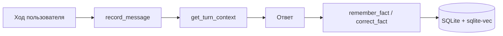
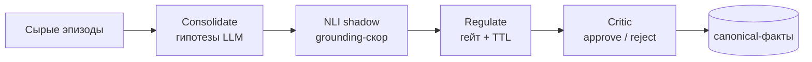

<div align="center">

# 🧠 memory-mcp-server

**Постоянная, проверенная долговременная память для локальных LLM — в одном SQLite-файле.**

Полностью офлайн · Без облака · Без внешней векторной БД · Без телеметрии

[](https://github.com/evrelse12/memory-mcp-server/actions/workflows/ci.yml)
[](LICENSE)
[](https://www.python.org)
[](https://modelcontextprotocol.io)

[Быстрый старт](#-быстрый-старт) ·
[Как работает](#-как-работает) ·
[Бенчмарки](#-бенчмарки) ·
[Сравнение](#-сравнение) ·
[Документация](#-документация) ·
[Roadmap](#-roadmap)

</div>

---

## Зачем это

Локальные LLM забывают всё между сессиями. Векторная БД даёт *поиск*, а не *память*:
без забывания, без провенанса, без защиты от уверенных, но ошибочных выводов.

**memory-mcp-server** ведёт себя как память: консолидирует опыт, забывает
неактуальное, ведёт каждый факт к источнику и изолирует непроверенные выводы LLM,
пока адверсариальный критик не докажет их по исходному диалогу. Всё в одном
переносимом `.db`-файле, на вашей машине.

## ✨ Особенности

- 🗃 **Один файл** — SQLite (WAL) + `sqlite-vec`. Больше ничего не деплоить.
- 🔍 **Гибридный поиск** — FTS5 (RU/EN) + dense KNN + RRF + граф и сущности.
- 📉 **Забывание — фича** — затухание Эббингауза, подкрепление, ночная чистка.
- 🛡 **Проверенная память** — Consolidation → Reflection: NLI-гейт + критик.
- 🧾 **Провенанс** — `derived_from` и `supersedes`; `explain_fact` показывает цепочку.
- 📌 **Директивы и конфликты** — жёсткие ограничения всегда в контексте; противоречие
  вызывает вопрос, а не тихую перезапись.
- 🔌 **Два транспорта** — stdio и HTTP + bearer.
- 🏠 **Local-first** — телеметрия и апдейт-чеки FastMCP выключены.

## 🚀 Быстрый старт

```bash
git clone https://github.com/evrelse12/memory-mcp-server.git
cd memory-mcp-server
python3 -m venv venv && ./venv/bin/pip install -e .
```

Подними embedding- и chat-серверы (подойдёт llama.cpp `llama-server`):

```bash
llama-server -m nomic-embed-text-v2-moe-q8_0.gguf --embedding --pooling mean --port 8081
llama-server -m <chat-model>.gguf -a <alias> --jinja --port 9931
```

Запусти как MCP (stdio) или подключи к хосту:

```json
{ "mcpServers": { "memory": {
  "command": "/path/to/venv/bin/python3",
  "args": ["/path/to/main.py"],
  "env": {
    "MEMORY_DATA_DIR": "/path/to/project",
    "MEMORY_LLM_API_URL": "http://localhost:9931",
    "MEMORY_EMBEDDING_API_URL": "http://localhost:8081",
    "FASTMCP_CHECK_FOR_UPDATES": "off",
    "FASTMCP_TELEMETRY_MODE": "off"
  }
}}}
```

Полная установка, systemd и HTTP: **[docs/INSTALL.md](docs/INSTALL.md)**, **[docs/HTTP.md](docs/HTTP.md)**.

## 🧠 Как работает

**Ход** — записать, вспомнить, ответить, сохранить:



**Ночь** — Consolidation → Reflection:



Сказанное пользователем — canonical сразу. Выведенное LLM — гипотеза: скрыта от
ответов, проходит NLI по источникам, затем критика, обязанного ссылаться на
доказательства. Подробнее: **[docs/CONSOLIDATION_REFLECTION.md](docs/CONSOLIDATION_REFLECTION.md)**.

## 📊 Бенчмарки

**LongMemEval_S** (стратифицированные 20), локальный судья:

| Метрика | Результат |
|---|---|
| CI-тесты | **66 passed** (Ubuntu + Windows) |
| Retrieval recall@8 (session-level) | **1.00** |
| Accuracy **с памятью** | **0.53** |
| Accuracy **без памяти** | **0.20** |

Одни и те же 20 вопросов LongMemEval_S, один локальный судья: память более чем
удваивает контроль без памяти, а поиск находит evidence-сессию во всех вопросах.
A/B эмбеддеров (nomic vs bge-m3) проведён, но **неубедителен** на такой выборке —
nomic остаётся дефолтом. Полные таблицы и оговорки: **[docs/BENCHMARKS.md](docs/BENCHMARKS.md)**.

## 🆚 Сравнение

| | memory-mcp | mem0 | Zep | Letta (MemGPT) | обычный RAG |
|---|:---:|:---:|:---:|:---:|:---:|
| Один переносимый файл | ✅ | ❌ | ❌ | ❌ | ❌ |
| Полностью офлайн | ✅ | опция | ❌ | опция | зависит |
| Забывание / decay | ✅ | частично | temporal | агент | ❌ |
| Верификация гипотез | ✅ | ❌ | ❌ | ❌ | ❌ |
| Цепочка провенанса | ✅ | частично | ✅ | частично | ❌ |
| Жёсткие директивы | ✅ | ❌ | ❌ | ❌ | ❌ |

## ⚙️ Конфигурация

Всё через env (`MEMORY_*`), разумные дефолты:

```bash
MEMORY_DATA_DIR=/path/to/project
MEMORY_LLM_API_URL=http://localhost:9931
MEMORY_EMBEDDING_API_URL=http://localhost:8081
MEMORY_TRANSPORT=stdio          # или http (+ MEMORY_HTTP_TOKEN)
```

Полный справочник: **[docs/CONFIGURATION.md](docs/CONFIGURATION.md)**.

## 📚 Документация

| | |
|---|---|
| 📦 [Установка](docs/INSTALL.md) | серверы, systemd, подключение к хосту |
| ⚙️ [Конфигурация](docs/CONFIGURATION.md) | все env-переменные, fail-fast |
| 🏗 [Архитектура](docs/ARCHITECTURE.md) | хранилище, схема v4, гибридный поиск |
| 🛡 [Consolidation & Reflection](docs/CONSOLIDATION_REFLECTION.md) | пайплайн верификации |
| 🔌 [HTTP](docs/HTTP.md) | bearer, multi-client |
| 📝 [System prompt](docs/SYSTEM_PROMPT.md) | эталонный протокол хода |
| 📊 [Бенчмарки](docs/BENCHMARKS.md) | протокол, результаты, A/B |
| 🧯 [Troubleshooting](docs/TROUBLESHOOTING.md) | «0 tools», пустой content, macOS |

## 🗺 Roadmap

- [x] Гибридный поиск + забывание Эббингауза
- [x] Директивы, конфликты, провенанс
- [x] HTTP + bearer
- [x] Consolidation → Reflection (NLI + критик)
- [x] Бенч-харнес (LongMemEval / LoCoMo)
- [ ] Финальные таблицы бенчмарков и релиз v0.8.0
- [ ] Измеренный A/B эмбеддеров (nomic vs bge-m3)
- [ ] Опциональный малый ONNX-судья / agentic-критик

## 🤝 Contributing

Issues и PR приветствуются. Перед отправкой: `./venv/bin/pytest -q` и
`./venv/bin/ruff check .`. См. [docs/CONTRIBUTING.md](docs/CONTRIBUTING.md).

## 📄 Лицензия

MIT © [evrelse12](https://github.com/evrelse12)

<div align="center">
<sub>Local-first, privacy-respecting AI. Один файл — настоящая память.</sub>
</div>
